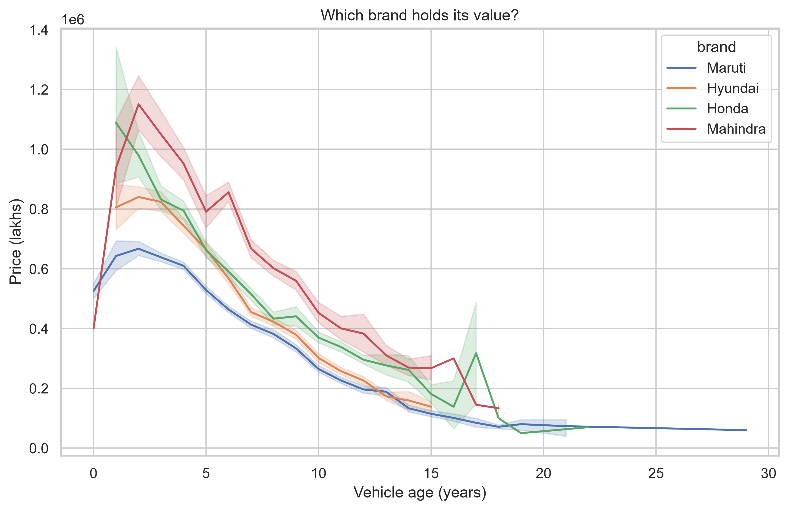
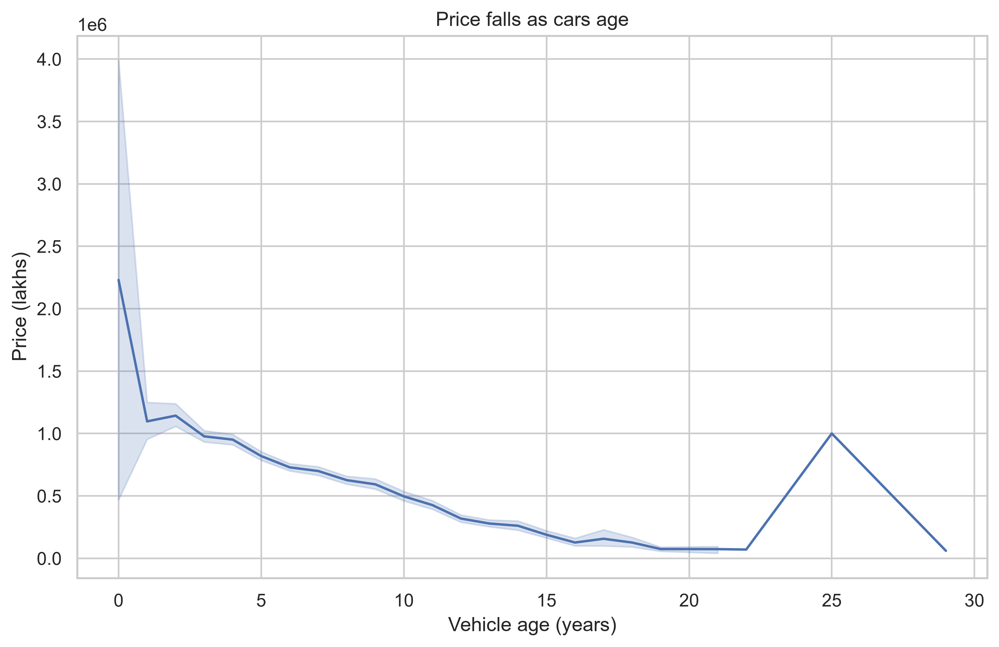
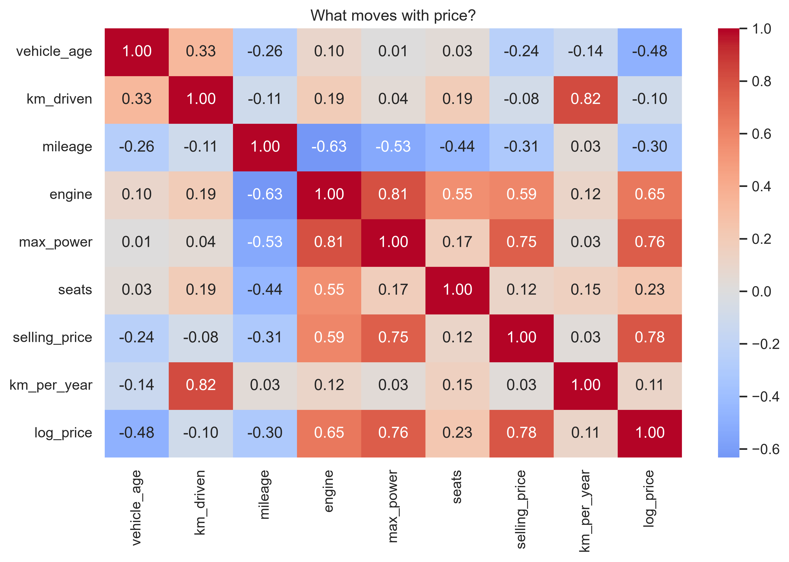

# Used Car Market Analysis (India)

An exploratory data analysis of the used car market, uncovering pricing trends, depreciation patterns, brand-wise performance, and key factors influencing resale value using Python.

## Dataset
Source: CarDekho Used Car Dataset
(https://www.kaggle.com/datasets/manishkr1754/cardekho-used-car-data)

15,411 cars, 14 columns: brand, model, vehicle age, km driven, fuel type, transmission, mileage, engine, max power, seats, and selling price.

## Tools
Python, NumPy, Pandas, Matplotlib, Seaborn

## What I did
- Cleaned the data and created new features (km per year)
- Answered 10 business questions with Pandas
- Used NumPy for outlier detection, log transforms, and correlation
- Built 8 visualizations

## Key findings
1. Automatic cars sell for about 179.43% more than manual ones on average. 
2. Diesel cars cost 24 lakhs more than petrol cars on average
3. Cars lose approximately 56.18% of their value in the first 3 years

## Charts

## Limitations
- Listing prices, not final sale prices
- No data on car condition or city

## What I Learned
- Cleaning and transforming real-world data with Pandas
- Using NumPy for outlier detection, log transforms, and correlation
- Turning questions into insights through groupby, filtering, and pivot tables
- Creating clear, labeled visualizations with Matplotlib and Seaborn

## Future Scope
This project focuses on data cleaning, analysis, and visualization. Possible extensions include a price prediction model and an interactive dashboard.

## How to run
1. Clone the repo
2. `pip install -r requirements.txt`
3. Open `notebooks/car_analysis.ipynb`
